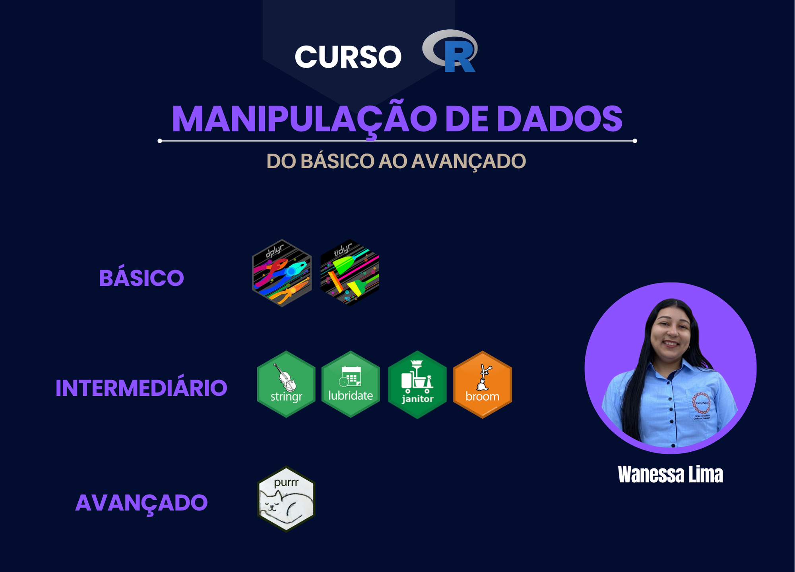
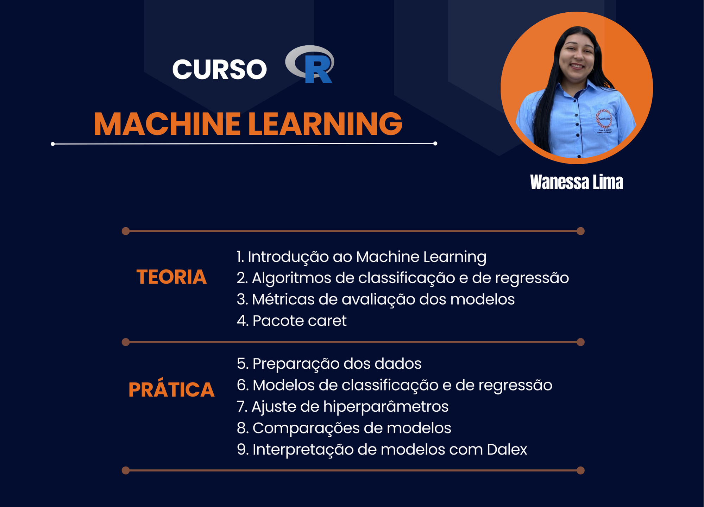
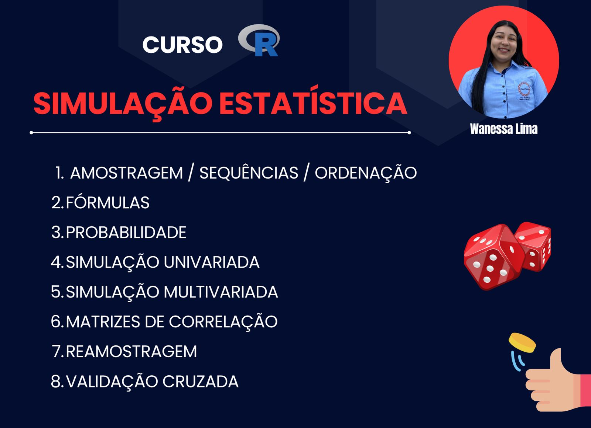
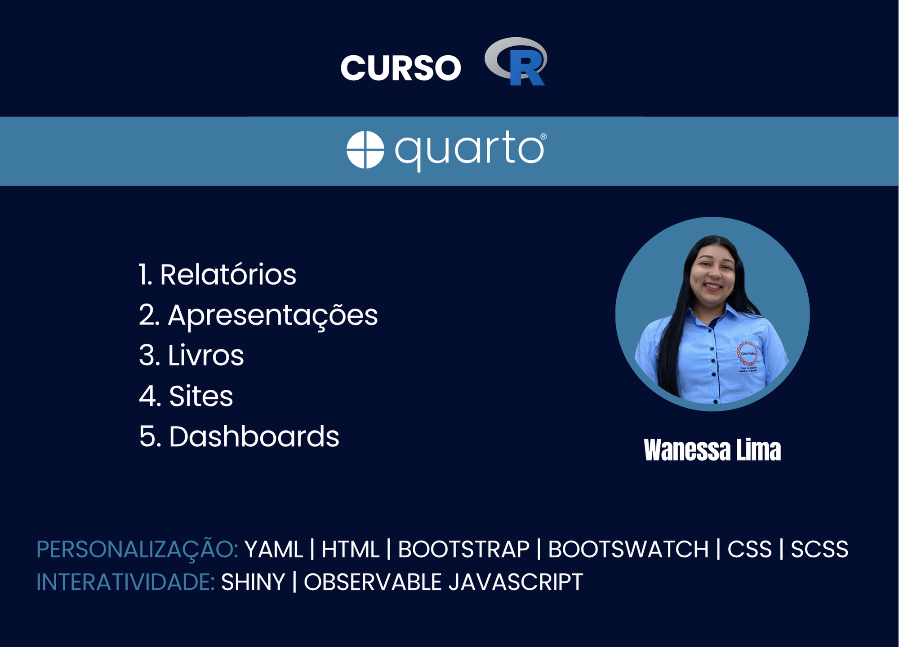
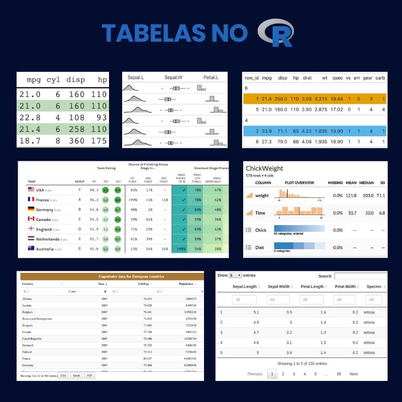

Você busca visualizar, manipular e analisar dados com precisão, construir modelos estatísticos e de Machine Learning e atender às suas próprias demandas analíticas utilizando o software R?

Eu ministro cursos em R com uma abordagem estruturada e progressiva, cujo fluxo didático claro e consistente foi desenvolvido ao longo de anos de dedicação ao estudo, à prática e à organização do conhecimento, visando facilitar a compreensão e evitar lacunas conceituais. O objetivo é promover um aprendizado eficiente, coerente e sem dispersão, otimizando o tempo do aluno.

Confira minha aula introdutória ao R, para que você conheça meu estilo e fluxo de aula:

[{width="500"}](https://drive.google.com/file/d/1TKGXW-081mQ_781GAGS_xUktuVTaITuk/view?usp=sharing)

Caso você goste da didática e ritmo da minha aula, e faça sentido a construção do conhecimento da forma apresentada, considere adquirir cursos específicos para aprofundar seus conhecimentos:

[{width="500"}](https://pay.hotmart.com/B98843429D)

[{width="500"}](https://pay.hotmart.com/C97834484G)

[{width="500"}](https://pay.hotmart.com/X100551937O)

[{width="500"}](https://pay.hotmart.com/F98913860K)

[{width="500"}](https://pay.hotmart.com/U103160681J)

Além dos cursos, realizo consultoria particular, direcionada a estudantes, pesquisadores e profissionais que necessitam de apoio personalizado, seja na estruturação de análises, escolha de métodos estatísticos, implementação de modelos, organização de projetos ou interpretação de resultados.

Contate-me: wanessa.a.lima@ufv.br
